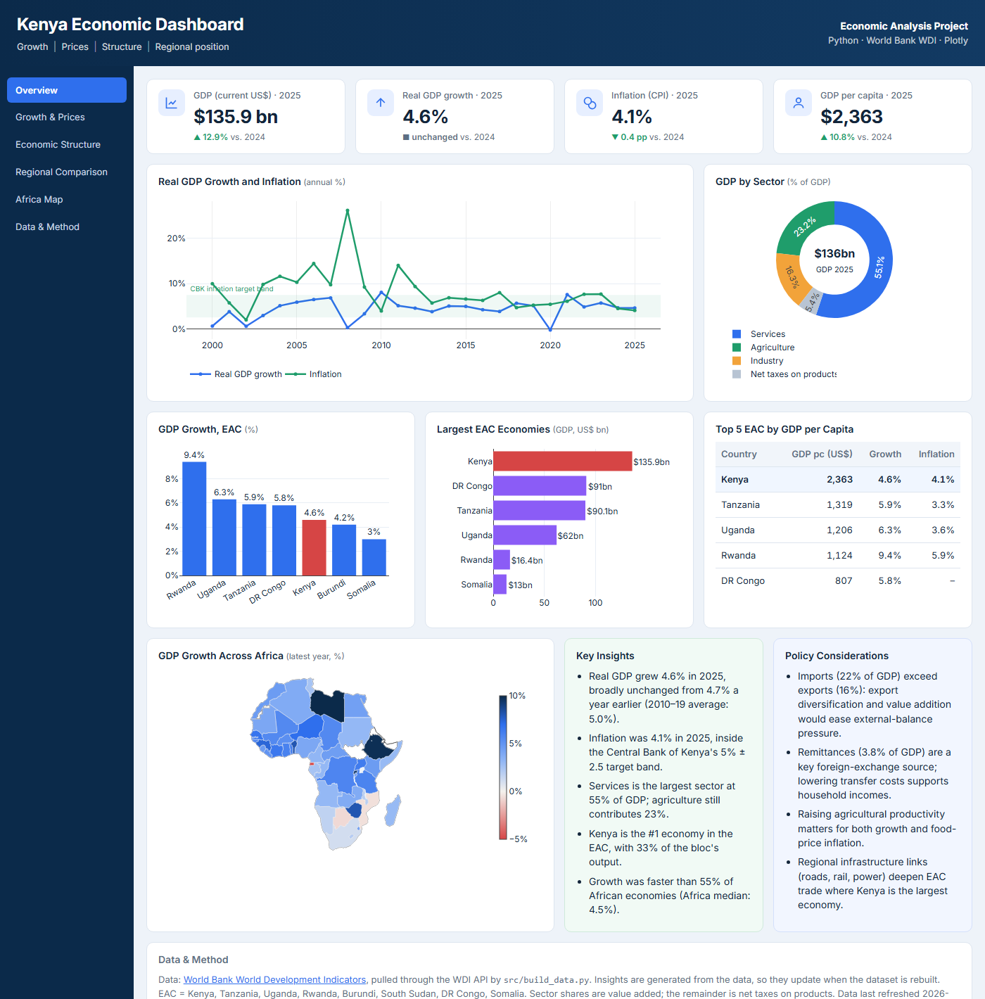

# Kenya Economic Dashboard

An interactive dashboard of Kenya's macroeconomic performance and regional position, built on live World Bank data.

### 🔗 [Open the live dashboard](https://sinedaniam.github.io/kenya-economic-dashboard/)



## What it shows

| Panel | Content |
|---|---|
| **KPI cards** | GDP (US$), real GDP growth, CPI inflation and GDP per capita, each with its change from the previous year |
| **Growth and inflation trend** | 2000 to the latest year, with the Central Bank of Kenya's inflation target band shaded |
| **GDP by sector** | Services, agriculture and industry shares of GDP |
| **EAC comparison** | Growth and economy size for East African Community members, with Kenya highlighted |
| **Top 5 table** | EAC economies ranked by GDP per capita, with growth and inflation |
| **Africa map** | Choropleth of the latest GDP growth for every African economy |
| **Key insights and policy considerations** | Generated from the data, so the text stays accurate when the numbers update |

## How it works

```
World Bank WDI API ──► src/build_data.py ──► docs/data.json ──► docs/index.html (Plotly.js)
```

- **`src/build_data.py`** downloads 11 indicators for 51 African economies. It computes the KPIs, regional comparisons and rankings, and writes the insight sentences from the numbers.
- **`docs/index.html`** is a single static page that reads `data.json` and draws the charts with Plotly.js. It's hosted free on GitHub Pages and works on mobile.
- **`.github/workflows/refresh-data.yml`** reruns the pipeline on the 1st of every month and commits new data, so the dashboard stays current without manual updates.

## Indicators

| Indicator | WDI code |
|---|---|
| GDP (current US$) | `NY.GDP.MKTP.CD` |
| GDP growth (annual %) | `NY.GDP.MKTP.KD.ZG` |
| GDP per capita (current US$) | `NY.GDP.PCAP.CD` |
| Inflation, consumer prices (annual %) | `FP.CPI.TOTL.ZG` |
| Agriculture, industry, services value added (% of GDP) | `NV.AGR.TOTL.ZS`, `NV.IND.TOTL.ZS`, `NV.SRV.TOTL.ZS` |
| Exports and imports (% of GDP) | `NE.EXP.GNFS.ZS`, `NE.IMP.GNFS.ZS` |
| Personal remittances received (% of GDP) | `BX.TRF.PWKR.DT.GD.ZS` |
| Population | `SP.POP.TOTL` |

## Run locally

```bash
pip install -r requirements.txt
python src/build_data.py          # delete data/wdi_raw.csv first to force a fresh download
python -m http.server -d docs     # then open http://localhost:8000
```

## Notes

- The latest values are the World Bank's figures. Recent years can include estimates that are revised later.
- EAC here means Kenya, Tanzania, Uganda, Rwanda, Burundi, South Sudan, DR Congo and Somalia. Countries without recent data are left out of a chart.
- The policy considerations are an economist's reading of the indicators, not official policy positions.

---
*Author: Denis Mburu, Economist and Statistician*
